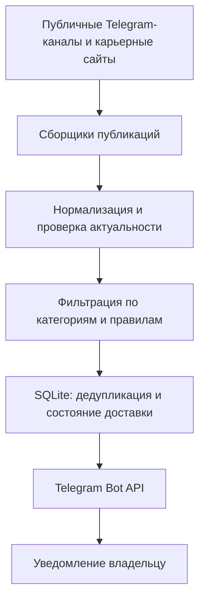
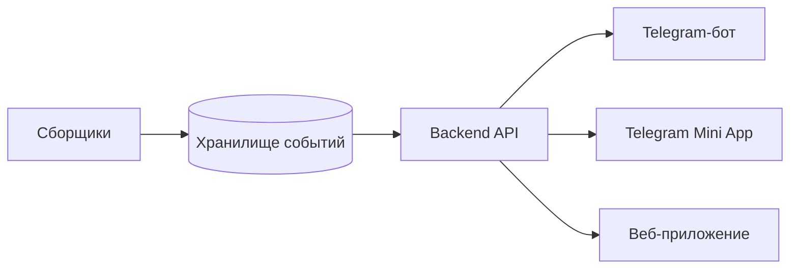

# IT Radar Bot 📡

**Telegram-бот для поиска IT-возможностей: стажировок, мероприятий, хакатонов и карьерных программ.**

[](https://www.python.org/)
[](https://docs.docker.com/compose/)


**[Открыть бота в Telegram](https://t.me/it_start_radar_bot)** · [Результаты проверки](docs/acceptance.md) · [Техническая документация](docs/)

## О проекте

**IT Radar Bot** помогает студентам и начинающим IT-специалистам не пропускать стажировки, хакатоны, конференции, митапы и другие карьерные возможности.

Бот регулярно проверяет выбранные публичные источники, отбирает публикации по настраиваемым правилам и отправляет подходящие объявления в Telegram. Повторы, устаревшие события, явно закрытые регистрации и нерелевантная реклама отфильтровываются.

> **Текущий статус:** рабочий локальный прототип. Реальная доставка Telegram-сообщения, команды управления и сохранение состояния после перезапуска проверены. Сейчас бот работает для одного владельца; это не публичный многопользовательский сервис.

## Возможности

- **Автоматический мониторинг** источников с интервалом по умолчанию **1 час**.
- **9 подключённых источников:** 7 публичных Telegram-каналов и карьерные страницы **К2** и **КРОК**.
- **Четыре категории:** стажировки и junior-программы; IT-мероприятия; хакатоны и конкурсы; карьерные встречи.
- **Фильтрация по правилам:** ключевые слова, стоп-слова, IT-контекст, актуальность, статус регистрации.
- **Защита от дублей:** SQLite хранит идентификаторы публикаций и состояние доставки.
- **Уведомления со ссылками:** категория, источник, описание, оригинальная публикация и ссылка для заявки (если обнаружена).
- **Устойчивость к сбоям:** ошибка отдельного источника не останавливает весь мониторинг; состояние переживает перезапуск контейнера.
- **Управление через Telegram** с ограничением доступа по `OWNER_TELEGRAM_ID`.

### Команды

| Команда | Действие |
| --- | --- |
| `/start` | Включить уведомления |
| `/stop` | Отключить уведомления без остановки сбора |
| `/status` | Показать состояние источников и сохранённых публикаций |
| `/help` | Показать справку |
| `/check` | **В планах:** немедленно запустить проверку источников |

### Источники

**Telegram:** `rostelecom_tech`, `rostelecom_molodezh`, `CTDLru`, `mgtsstudents`, `brainzbycroc`, `k2cybersec_team`, `rvision_team`. Публикации читаются с публичных страниц `t.me/s/...`, без авторизации пользовательским Telegram-аккаунтом.

**Сайты компаний:** [К2](https://careers.cybersecurity.k2.tech/vacancy) (публичный каталог вакансий) и [КРОК](https://careers.croc.ru/vacancies/?_sft_expirience=0-1-%D0%B3%D0%BE%D0%B4) (вакансии с опытом 0–1 год).

**Ограничение:** источник РТК ИТ предусмотрен в конфигурации, но не подключён: его API требует авторизацию (HTTP 401). Бот не обходит ограничения доступа.

## Как работает



При первом запуске бот формирует **исходный снимок (baseline)**: уже существующие объявления сохраняются без массовой рассылки. Далее уведомления создаются для новых подходящих публикаций. Перед доставкой публикация проверяется повторно. Неоднозначные результаты отправки не повторяются автоматически, чтобы не создавать дубли.

## Технологии

| Компонент | Используется |
| --- | --- |
| Язык | Python 3.12 |
| HTTP и HTML | `requests`, `BeautifulSoup` |
| Конфигурация | YAML, переменные окружения |
| Хранение | SQLite |
| Развёртывание | Docker, Docker Compose |
| Интеграция | Telegram Bot API |
| Тесты | `unittest`, отдельные проверки правил |

Зависимости зафиксированы в `requirements.txt`; Docker-сборка включает запуск тестов. Логи приложения выводятся в stderr с маскированием чувствительных значений.

## Быстрый старт

**Требования:** Docker и Docker Compose, токен бота от [@BotFather](https://t.me/BotFather), числовой Telegram ID владельца.

```bash
git clone https://github.com/waitran/it_radar_bot.git
cd it_radar_bot
cp .env.example .env
chmod 600 .env
```

> Репозиторий сейчас приватный: для клонирования потребуется доступ.

Откройте `.env` локальным редактором и задайте:

```dotenv
TELEGRAM_BOT_TOKEN=your_telegram_bot_token
OWNER_TELEGRAM_ID=your_numeric_telegram_id
POLL_INTERVAL_SECONDS=3600
```

**Не коммитьте `.env` и не публикуйте токены.** После настройки:

```bash
docker compose config --quiet
docker compose up -d --build
docker compose logs --tail 50 -f
```

Проверить состояние:

```bash
docker compose ps
```

Остановить сервис без удаления данных:

```bash
docker compose stop
```

SQLite хранится в Docker volume. Не запускайте `docker compose down -v`, если хотите сохранить историю.

### Тесты

Для локальных проверок нужен Python 3.12:

```bash
python3.12 -m venv .venv
source .venv/bin/activate
python -m pip install --no-deps -r requirements.txt
python -m pip check
python -m tests.test_rules
python -m unittest discover -s tests -v
```

## Планы развития

Следующие возможности **ещё не реализованы** и не входят в текущий функционал.

### 1. Проверка по команде `/check`

Ручной запуск внепланового опроса источников без ожидания следующего часового цикла. Планируется показать пользователю статус проверки, количество новых событий и ошибки источников. Для безопасности — ограничение частоты вызовов и защита от параллельных проверок.

### 2. Telegram Mini App

Интерфейс внутри Telegram, в котором можно будет просматривать найденные события, фильтровать их по категориям и источникам, открывать ссылки регистрации и настраивать интересы. Потребуются отдельный backend/API и проверка данных инициализации Telegram.

### 3. Веб-приложение

Отдельная веб-страница с каталогом актуальных возможностей, поиском, фильтрами и карточками мероприятий. Планируется переиспользовать общую базу данных и API, чтобы бот, Mini App и сайт работали с одним набором событий.

**Предполагаемая архитектура после расширения:**



Это целевая схема, а не описание текущей реализации.

## Проверка и ограничения

По [отчёту приёмки от 23–24 октября 2026 года](docs/acceptance.md):

- Проверены чтение 7 Telegram-каналов и 2 карьерных сайтов, доставка тестового сообщения и команды владельца.
- После перезапуска Docker Compose состояние SQLite сохранилось.
- На этапе проверки хранения и доставки прошли **160 автоматических тестов**.
- Мониторинг выполняется **локально**: если компьютер выключен или спит, сбор останавливается.
- Изображения не распознаются OCR, а доступность внешних регистрационных форм не гарантируется.

Подробности: [приёмка](docs/acceptance.md), [Telegram-сбор](docs/telegram-checks.md), [сайты](docs/websites-checks.md), [фильтрация](docs/selection-checks.md), [доставка](docs/delivery-checks.md).

## Автор

**[waitran](https://github.com/waitran)** — pet-проект для практики Python-разработки, автоматизации, интеграций и эксплуатации контейнеризованных сервисов.
