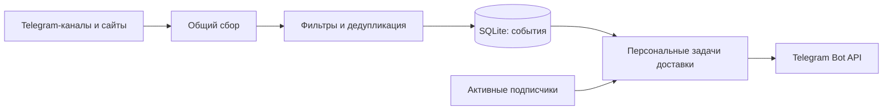

<div align="center">

# 📡 IT Radar Bot

**Стажировки, хакатоны и IT-события — в вашем Telegram**

Бот отслеживает публичные источники, отбирает подходящие возможности<br>
и отправляет каждому подписчику новые публикации без рассылки архива.

[](https://www.python.org/)
[](https://docs.docker.com/compose/)


[Открыть бота](https://t.me/it_start_radar_bot) · [Быстрый старт](#быстрый-старт) · [Обновление](#обновление-существующей-установки) · [Документация](#документация)

</div>

---

## Возможности

- **Независимые подписки.** Любой пользователь может включить уведомления; его команды не влияют на остальных.
- **Общий сбор.** Telegram-каналы и сайты опрашиваются один раз для всех подписчиков.
- **Тематический отбор.** Бот проверяет IT-контекст, категории, уровень вакансии, сроки и признаки закрытия.
- **Без архива и автоматических дублей.** Новая подписка не запускает рассылку накопленных записей; история доставки хранится отдельно для каждого получателя.
- **Восстановление после перезапуска.** Подписчики, курсоры источников и очередь сохраняются в SQLite на постоянном Docker volume.
- **Изоляция ошибок.** Недоступный источник или блокировка бота одним пользователем не отключают остальных подписчиков.

## Что отслеживается

| Категория | Примеры |
| :--- | :--- |
| 🎓 Стажировки | Стажировки, практики, программы для начинающих, junior / entry-level позиции |
| 🎤 Мероприятия | Митапы, конференции, лекции, воркшопы, вебинары, дни открытых дверей |
| 🏆 Соревнования | Хакатоны, олимпиады, конкурсы, CTF, кейс-чемпионаты |
| 💼 Карьерные возможности | Карьерные встречи, ярмарки вакансий, дни карьеры, подработка для студентов |

Правила общие для всех подписчиков и настраиваются в [`config.yaml`](config.yaml): ключевые слова, исключения, минимальный балл и максимальный возраст публикации. Обычные новости компаний, реклама, явно закрытые и просроченные объявления отсекаются. При неизвестном статусе регистрации бот не утверждает, что она открыта.

## Команды

Откройте [@it_start_radar_bot](https://t.me/it_start_radar_bot) в личном чате и отправьте `/start`.

| Команда | Действие |
| :--- | :--- |
| `/start` | Создать или возобновить личную подписку |
| `/stop` | Отключить свои уведомления и отменить ожидающие отправки задачи |
| `/status` | Посмотреть личный статус подписки и доставки |
| `/help` | Получить справку, в том числе без подписки |

Повторный `/start` при активной подписке не создаёт дубликатов. Telegram ID берётся из отправителя входящего update; ID в тексте команды не используется. Неизвестная команда возвращает подсказку.

**Как работает подписка без архива:**

- После `/start` поступают только новые подходящие события, а пропущенные за время паузы не догоняются.
- Подписка во время сбора начинает получать события со следующего цикла.
- Первый снимок нового источника становится исходной точкой — **baseline**.
- Для публикаций без даты первый успешный снимок источника после подписки или возобновления также служит личным baseline. Это может пропустить недавно появившуюся запись, зато исключает отправку неизвестного архива.

Администратору с `OWNER_TELEGRAM_ID` также доступен `/check`: запрос общего сбора и итог проверки, не чаще раза в минуту. Публичный персональный `/check` пока запланирован.

## Источники

### Telegram

Каналы читаются через открытые страницы `t.me/s/<username>`, без пользовательского аккаунта, Telethon, Pyrogram или MTProto.

| Канал | Канал |
| :--- | :--- |
| [Ростелеком Технологии](https://t.me/rostelecom_tech) | [Молодёжь Ростелекома](https://t.me/rostelecom_molodezh) |
| [CTDLru](https://t.me/CTDLru) | [mgtsstudents](https://t.me/mgtsstudents) |
| [brainzbycroc](https://t.me/brainzbycroc) | [k2cybersec_team](https://t.me/k2cybersec_team) |
| [rvision_team](https://t.me/rvision_team) | |

### Сайты компаний

| Источник | Способ сбора | Статус подключения |
| :--- | :--- | :--- |
| [К2 Кибербезопасность](https://careers.cybersecurity.k2.tech/vacancy) | Публичный JSON-каталог Tilda и описания вакансий | Подключён |
| [КРОК](https://careers.croc.ru/vacancies/) | Каталог с проверкой фильтра опыта 0–1 год и страницы вакансий | Подключён |
| [РТК ИТ](https://rtkit.ru/careers) | Публичный API | Не подключён: при проверке возвращал 401; демоданные не используются |

Список источников задаётся в [`config.yaml`](config.yaml). Статус подключения описывает поддержку сборщиком, а не гарантирует текущую доступность сайта. Ошибки фиксируются в логах; ограничения доступа не обходятся.

## Быстрый старт

Нужны Docker с Docker Compose и токен бота от [@BotFather](https://t.me/BotFather).

### 1. Подготовьте окружение

Если репозиторий ещё не загружен, клонируйте его (для приватного репозитория потребуется доступ):

```bash
git clone https://github.com/waitran/it_radar_bot.git
cd it_radar_bot
```

В каталоге репозитория:

```bash
cp -n .env.example .env
chmod 600 .env
```

Откройте `.env` локальным редактором и заполните `TELEGRAM_BOT_TOKEN`. Не публикуйте токен и не записывайте его в исходники.

| Переменная | Значение по умолчанию | Назначение |
| :--- | :--- | :--- |
| `TELEGRAM_BOT_TOKEN` | Обязательно задать | Токен Telegram-бота |
| `OWNER_TELEGRAM_ID` | `0` | Необязательный администратор; нужен для переноса прежнего владельца, если ID не сохранён в БД |
| `POLL_INTERVAL_SECONDS` | `3600` | Интервал общего сбора источников |
| `DB_PATH` | `/data/bot.db` в Compose | Путь к SQLite; в шаблоне для локального Python — `./data/bot.db` |

Для новой установки `OWNER_TELEGRAM_ID` не требуется. Каждый пользователь регистрируется самостоятельно через `/start`.

### 2. Соберите и запустите

```bash
docker compose build
docker compose up -d --no-build
docker compose logs --tail=100 -f
```

Сборка выполняет проверки зависимостей и автоматические тесты. `Ctrl+C` завершает просмотр логов, а контейнер продолжает работать в фоне.

### 3. Включите подписку

Отправьте своему боту `/start`, затем `/status`. Первый сбор нового источника сохраняет baseline без отправки архива. Для постоянного мониторинга компьютер и Docker должны оставаться включёнными.

> **Сохранность данных:** Compose хранит SQLite в named volume `bot-data`. Пересоздание контейнера сохраняет данные. Команда `docker compose down -v` удаляет volume вместе с подписчиками и историей.

## Обновление существующей установки

Выполняйте команды из прежнего каталога Compose, сохраняя имя проекта и существующий volume. В `.env` оставьте прежний `OWNER_TELEGRAM_ID` на время переноса старой подписки.

```bash
# Сборка новой версии не останавливает работающий контейнер.
docker compose build

# Штатно остановите старую версию перед копированием SQLite.
docker compose stop
mkdir -p backups
chmod 700 backups
docker compose cp it-radar-bot:/data/bot.db "backups/bot-$(date +%Y%m%d-%H%M%S).db"
chmod 600 backups/*.db

# Продолжайте после успешного резервного копирования.
docker compose up -d --no-build
docker compose logs --tail=100 -f
```

Путь копирования предполагает стандартный `DB_PATH=/data/bot.db`. Миграция дополнительно создаёт резервную копию рядом с базой, сохраняет историю владельца и не запускает повторную массовую рассылку. Если прежний ID владельца неизвестен базе и не задан в окружении, запуск потребует указать его для переноса.

После запуска проверьте `/status` прежнего владельца и подписку двух аккаунтов. Отключение одного через `/stop` не должно менять состояние другого.

Подробности миграции, ручного разбора доставок и отката: **[руководство по многопользовательскому режиму](docs/multiuser.md)**.

## Архитектура и хранение



| Таблица | Что хранит |
| :--- | :--- |
| `seen_items` | Общие публикации, полный контекст, baseline и границы рассылки |
| `item_aliases` | Идентификаторы для дедупликации по конкретным нормализованным ссылкам |
| `source_state` | Состояние и ошибки источников |
| `users` | Telegram ID, необязательный username, активность и время подписки |
| `user_deliveries` | Статус, попытки, время отправки и Telegram message ID для пары пользователь–событие |
| `command_replies` | Отложенные ответы на команды, в том числе во время паузы 429 |
| `flags`, `runs` | Курсоры, offset long polling, служебные настройки и история циклов |

Уникальность `(telegram_id, item_key)` исключает повторное создание одной персональной доставки. Старые поля доставки в `seen_items` сохранены для аудита; текущая очередь находится в `user_deliveries`.

Перед отправкой бот повторно проверяет актуальность и правила отбора. Основные переходы состояния:

```text
pending → sending → sent
                  → pending     безопасная повторная попытка
                  → uncertain   результат неизвестен, автоматического повтора нет
                  → failed      подтверждённый отказ API
```

При перезапуске незавершённое `sending` становится `uncertain`. Ошибка 403 отключает только получателя; 429 задаёт общую паузу по `retry_after`. Публикация, утратившая актуальность, получает `expired`, отменённая доставка — `skipped`.

Новые задачи добавляются порциями до 500; одновременно допускается до 10 000 ожидающих или выполняемых задач. Недостающие задачи восстанавливаются из сохранённых границ событий и подписок. История сохраняется, поэтому при росте аудитории увеличиваются задержка рассылки и объём базы.

SQLite Backup API обеспечивает резервирование при миграции. Файловая блокировка защищает от второго процесса на той же базе; сохранённый ID бота предотвращает случайное использование базы другим Telegram-ботом.

## Технологии

| Компонент | Используется |
| :--- | :--- |
| Язык | Python 3.12 |
| HTTP и HTML | `requests`, `BeautifulSoup` |
| Конфигурация | YAML, переменные окружения |
| Хранение | SQLite |
| Развёртывание | Docker, Docker Compose |
| Интеграция | Telegram Bot API |
| Тесты | `unittest`, отдельные проверки правил |

## Разработка и проверки

Целевая среда — **Python 3.12.12 / Debian Bookworm**. Базовый Docker-образ закреплён digest, прямые и транзитивные зависимости — точными версиями в [`requirements.txt`](requirements.txt).

```bash
python3.12 -m venv .venv
. .venv/bin/activate
python -m pip --isolated install --index-url https://pypi.org/simple --no-deps -r requirements.txt
python -m pip check
python -m tests.test_rules
python -m unittest discover -s tests -v
```

Тесты используют вымышленные токены, подмену HTTP и временные SQLite-базы. Доступ к реальному Telegram и внешним источникам не требуется. Проверки правил запускаются отдельно, поскольку написаны как функции, а не `unittest.TestCase`.

**Проверено 24 октября 2026 года:** проверки правил, 176 unittest-тестов и `docker compose build` завершились успешно. Docker-сборка повторяет проверки на Python 3.12.12. Живая приёмка многопользовательской версии двумя Telegram-аккаунтами при разработке миграции не проводилась.

<details>
<summary><strong>Локальный запуск и диагностика конфигурации</strong></summary>

Python самостоятельно не читает `.env`. Загрузите доверенный локальный файл в окружение shell; значения с пробелами должны быть заключены в кавычки:

```bash
set -a
. ./.env
set +a
python -m app.main --check-config
mkdir -p data
python -m app.main
```

`--check-config` проверяет формат настроек без сети и открытия SQLite. Это не проверка действительности токена. Код возврата: `0` — настройки корректны, `2` — ошибка конфигурации.

Диагностика персональных доставок выполняется при остановленном основном процессе. Примеры `--delivery-status`, `--telegram-id` и безопасного ручного разбора приведены в [руководстве](docs/multiuser.md).

</details>

<details>
<summary><strong>Секреты и зависимости</strong></summary>

`.env`, базы и логи исключены из Git; Docker-контекст не содержит секретов и истории Git. Если токен ранее был опубликован, его необходимо отозвать: удаление из файла не заменяет отзыв. Telegram-токены перевыпускаются через @BotFather, GitHub-токены — в настройках GitHub. Самому боту GitHub-токен не нужен.

Логи направлены в stderr; форматтер маскирует настроенные секреты и распознаваемые Telegram/GitHub-токены, включая traceback. Это не очищает старые логи, историю shell или вывод сторонних инструментов. Не включайте `set -x` при загрузке секретов и не публикуйте вывод `docker inspect` или `docker compose config` без `--quiet`.

Зависимости обновляются отдельным изменением: установка в чистом Python 3.12, сохранение полного `pip freeze`, затем `pip check`, тесты и Docker-сборка. Автоматическое обновление при каждом запуске не используется. Фиксация версий не гарантирует доступность PyPI или побайтовую идентичность образов.

</details>

## Ограничения

Мониторинг выполняется локально: если компьютер выключен или спит, сбор останавливается.
Изображения не распознаются OCR, а доступность внешних регистрационных форм не гарантируется.
Mini App и веб-приложение пока не реализованы; для них планируется общий API с проверкой
данных инициализации Telegram для Mini App.

## Документация

| Руководство | Содержание |
| :--- | :--- |
| [Многопользовательский режим](docs/multiuser.md) | Подписки, схема v2, доставка, ограничения, обновление и откат |
| [Telegram-сборщики](docs/telegram-checks.md) | Публичные страницы, пагинация, даты и курсоры |
| [Сбор сайтов](docs/websites-checks.md) | Полнота каталогов, фильтры и ошибки доступа |
| [Правила отбора](docs/selection-checks.md) | Категории, сроки, контекст и размеченные примеры |
| [Исторический отчёт по доставке](docs/delivery-checks.md) | Состояния и проверки прежней однопользовательской версии |
| [Историческая приёмка](docs/acceptance.md) | Проверка прежней версии с реальной доставкой владельцу |

Отчёты прежних этапов описывают проверки на момент их проведения и не заменяют приёмку текущей версии.

## Roadmap

- [x] Общий сбор Telegram-каналов и поддерживаемых карьерных сайтов
- [x] Фильтрация, дедупликация и проверка актуальности перед отправкой
- [x] Независимые подписки и персональная история доставки
- [x] Миграция SQLite, резервное копирование и восстановление после перезапуска
- [x] Административный `/check` с ограничением частоты
- [ ] Публичный персональный `/check` с персональными результатами
- [ ] Пользовательские настройки категорий и источников
- [ ] Telegram Mini App для просмотра возможностей и управления предпочтениями
- [ ] Веб-приложение

## Автор

**[waitran](https://github.com/waitran)** — pet-проект для практики Python-разработки, автоматизации, интеграций и эксплуатации контейнеризованных сервисов.
