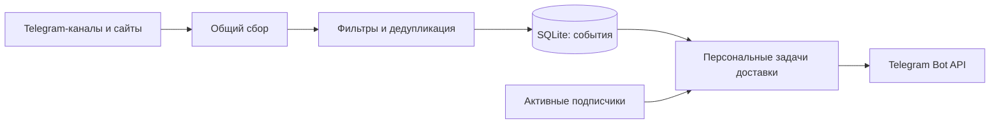

<div align="center">

# 📡 IT Radar Bot

**Стажировки, хакатоны и IT-события — в вашем Telegram**

Бот отслеживает публичные источники, отбирает подходящие возможности<br>
и отправляет каждому подписчику новые публикации без рассылки архива.

[](https://www.python.org/)
[](https://docs.docker.com/compose/)


[Открыть бота](https://t.me/it_start_radar_bot) · [Быстрый старт](#быстрый-старт) · [Обновление](#обновление-существующей-установки) · [Документация](#документация)

</div>

---

## Возможности

- **Независимые подписки.** Любой пользователь может включить уведомления; его команды не влияют на остальных.
- **Общий сбор.** Telegram-каналы и сайты опрашиваются один раз для всех подписчиков.
- **Тематический отбор.** Бот проверяет IT-контекст, категории, уровень вакансии, сроки и признаки закрытия.
- **Обработка изменений.** Изменённые ранее отклонённые публикации проверяются повторно; в Telegram пересматривается последняя публичная страница без дополнительных запросов. Уже отправленное событие не рассылается повторно.
- **Без архива и автоматических дублей.** Новая подписка не запускает рассылку накопленных записей; история доставки хранится отдельно для каждого получателя.
- **Восстановление после перезапуска.** Подписчики, курсоры источников и очередь сохраняются в SQLite на постоянном Docker volume.
- **Изоляция ошибок.** Недоступный источник или блокировка бота одним пользователем не отключают остальных подписчиков. Ошибка одной карточки вакансии не блокирует подтверждённые карточки полного каталога.

## Что отслеживается

| Категория | Примеры |
| :--- | :--- |
| 🎓 Стажировки | Стажировки, практики, программы для начинающих, junior / entry-level позиции |
| 🎤 Мероприятия | Митапы, конференции, лекции, воркшопы, вебинары, дни открытых дверей |
| 🏆 Соревнования | Хакатоны, олимпиады, конкурсы, CTF, кейс-чемпионаты |
| 💼 Карьерные возможности | Карьерные встречи, ярмарки вакансий, дни карьеры, подработка для студентов |

Правила общие для всех подписчиков и настраиваются в [`config.yaml`](config.yaml): ключевые слова, исключения, минимальный балл и максимальный возраст публикации. Обычные новости компаний, реклама, явно закрытые и просроченные объявления отсекаются. При неизвестном статусе регистрации бот не утверждает, что она открыта.

## Команды

Откройте [@it_start_radar_bot](https://t.me/it_start_radar_bot) в личном чате и отправьте `/start`.

| Команда | Действие |
| :--- | :--- |
| `/start` | Создать или возобновить личную подписку |
| `/stop` | Отключить свои уведомления и отменить ожидающие отправки задачи |
| `/status` | Посмотреть личный статус подписки и доставки |
| `/help` | Получить справку, в том числе без подписки |

Команды сохраняют изменение подписки сразу, а ответы отправляются общей очередью. Повторные команды одному пользователю объединяются в последний ответ; попытки ответа ограничены одним разом в пять секунд. При одновременном наличии готовых ответов и событий планировщик чередует их, поэтому поток команд не вытесняет уведомления.

Обработка команд не ждёт чужого HTTP-запроса. `/stop` отменяет следующие задачи; уже захваченная отправка может завершиться после команды. Подтверждение команды поступает через общую очередь.

Повторный `/start` при активной подписке не создаёт дубликатов. Telegram ID берётся из отправителя входящего update; ID в тексте команды не используется. Неизвестная команда возвращает подсказку.

**Как работает подписка без архива:**

- После `/start` поступают только новые подходящие события, а пропущенные за время паузы не догоняются.
- Подписка во время сбора начинает получать события со следующего цикла.
- Первый снимок нового источника становится исходной точкой — **baseline**.
- Для публикаций без даты первый успешный снимок источника после подписки или возобновления также служит личным baseline. Это может пропустить недавно появившуюся запись, зато исключает отправку неизвестного архива.

Администратору с `OWNER_TELEGRAM_ID` также доступен `/check`: запрос общего сбора и итог проверки, не чаще раза в минуту. Публичный персональный `/check` пока запланирован.

Правила отбора учитывают даты в CTF-анонсах, приглашениях и строках расписания с календарным значком. Даты без года относятся к году публикации; прошедшее событие не переносится автоматически на следующий год. Новостные обзоры, отчёты и образовательные карточки требуют явного приглашения к новому участию: одного упоминания регистрации или будущей даты недостаточно. Мероприятия для преподавателей отделяются от событий для студентов; преподаватель в роли спикера не является причиной отказа.

Отбор остаётся эвристическим: неоднозначные даты, сложные дайджесты и текст внутри изображений могут потребовать ручной проверки.

## Источники

### Telegram

Каналы читаются через открытые страницы `t.me/s/<username>`, без пользовательского аккаунта, Telethon, Pyrogram или MTProto.

| Канал | Канал |
| :--- | :--- |
| [Ростелеком Технологии](https://t.me/rostelecom_tech) | [Молодёжь Ростелекома](https://t.me/rostelecom_molodezh) |
| [CTDLru](https://t.me/CTDLru) | [mgtsstudents](https://t.me/mgtsstudents) |
| [brainzbycroc](https://t.me/brainzbycroc) | [k2cybersec_team](https://t.me/k2cybersec_team) |
| [rvision_team](https://t.me/rvision_team) | [tbank_education](https://t.me/tbank_education) |
| [education_yandex](https://t.me/education_yandex) | [hse_hack_club](https://t.me/hse_hack_club) |
| [fcs_hse](https://t.me/fcs_hse) | [it_sspace](https://t.me/it_sspace) |
| [leaders_hack](https://t.me/leaders_hack) | [hackathons_ai](https://t.me/hackathons_ai) |
| [gis_cybersec](https://t.me/gis_cybersec) | [careermiet](https://t.me/careermiet) |
| [rtumirea_official](https://t.me/rtumirea_official) | [competech](https://t.me/competech) |
| [hackathonsrus](https://t.me/hackathonsrus) | [hackathons](https://t.me/hackathons) |
| [ctfnews](https://t.me/ctfnews) | [RussianHackers_Channel](https://t.me/RussianHackers_Channel) |
| [futru_it](https://t.me/futru_it) | [freeitevent](https://t.me/freeitevent) |
| [meetupochnaya](https://t.me/meetupochnaya) | [Stud_Career](https://t.me/Stud_Career) |

В конфигурации 26 Telegram-каналов. `iteventsjuniors` не добавлен: публичная лента при проверке перенаправляла на страницу канала и не читалась сборщиком. Первый успешный снимок каждого нового источника создаёт baseline без рассылки архива; последующие новые публикации проходят общие правила отбора.

### Сайты компаний

| Источник | Способ сбора | Статус подключения |
| :--- | :--- | :--- |
| [К2 Кибербезопасность](https://careers.cybersecurity.k2.tech/vacancy) | Публичный JSON-каталог Tilda и описания вакансий | Подключён |
| [КРОК](https://careers.croc.ru/vacancies/) | Каталог с проверкой фильтра опыта 0–1 год и страницы вакансий | Подключён |
| [РТК ИТ](https://rtkit.ru/careers) | Публичный API | Не подключён: при проверке возвращал 401; демоданные не используются |

Список источников задаётся в [`config.yaml`](config.yaml). Статус подключения описывает поддержку сборщиком, а не гарантирует текущую доступность сайта. Ошибки фиксируются в логах; ограничения доступа не обходятся.

## Быстрый старт

Нужны Docker с Docker Compose и токен бота от [@BotFather](https://t.me/BotFather).

### 1. Подготовьте окружение

Если репозиторий ещё не загружен, клонируйте его (для приватного репозитория потребуется доступ):

```bash
git clone https://github.com/waitran/it_radar_bot.git
cd it_radar_bot
```

В каталоге репозитория:

```bash
cp -n .env.example .env
chmod 600 .env
```

Откройте `.env` локальным редактором и заполните `TELEGRAM_BOT_TOKEN`. Не публикуйте токен и не записывайте его в исходники.

| Переменная | Значение по умолчанию | Назначение |
| :--- | :--- | :--- |
| `TELEGRAM_BOT_TOKEN` | Обязательно задать | Токен Telegram-бота |
| `OWNER_TELEGRAM_ID` | `0` | Необязательный администратор; нужен для переноса прежнего владельца, если ID не сохранён в БД |
| `REQUEST_TIMEOUT_SECONDS` | `30` | Сетевой timeout HTTP-запросов к источникам, секунды; уменьшается по оставшемуся бюджету источника |
| `USER_AGENT` | Chrome/126 (см. `.env.example`) | User-Agent запросов к источникам; 1–512 печатных ASCII-символов |
| `BOT_UID` / `BOT_GID` | `10001` / `10001` | Непривилегированный пользователь контейнера и владелец volume |
| `MIN_FREE_DISK_MB` | `1024` | Порог свободного места для SQLite и копий; 0 отключает порог |
| `BOT_MEMORY_LIMIT` / `BOT_CPU_LIMIT` / `BOT_PIDS_LIMIT` | `512m` / `1.0` / `128` | Ограничения Docker |
| `MAX_QUEUE_AGE_SECONDS` | `86400` | Порог возраста активной очереди для healthcheck |
| `BACKUP_HOST_PATH` | `./backups` | Каталог хоста для проверенных копий вне volume SQLite |
| `BACKUP_INTERVAL_SECONDS` | `86400` | Интервал регулярного резервирования, секунды |
| `BACKUP_KEEP` | `7` | Число завершённых копий, минимум 2 |
| `ITEM_VERIFICATION_TTL_SECONDS` | `300` | Максимальный возраст подтверждения события перед отправкой, секунды |
| `SOURCE_TIMEOUT_SECONDS` | `600` | Кооперативный бюджет полного обхода одного источника, секунды |
| `POLL_INTERVAL_SECONDS` | `3600` | Интервал общего сбора источников |
| `DB_PATH` | `/data/bot.db` в Compose | Путь к SQLite; в шаблоне для локального Python — `./data/bot.db` |

`FIRST_RUN_LOOKBACK_HOURS` удалён: он не влиял на сбор. Если переменная осталась
в окружении, бот игнорирует её с предупреждением. Удалите её из старого `.env`.
Первый успешный снимок по-прежнему сохраняется как baseline без рассылки архива.

Для новой установки `OWNER_TELEGRAM_ID` не требуется. Каждый пользователь регистрируется самостоятельно через `/start`.

### 2. Соберите и запустите

```bash
docker compose build
docker compose up -d --no-build
docker compose logs --tail=100 -f
```

Сборка выполняет проверки зависимостей и автоматические тесты. `Ctrl+C` завершает просмотр логов, а контейнер продолжает работать в фоне.

### 3. Включите подписку

Отправьте своему боту `/start`, затем `/status`. Первый сбор нового источника сохраняет baseline без отправки архива. Для постоянного мониторинга компьютер и Docker должны оставаться включёнными.

> **Сохранность данных:** Compose хранит SQLite в named volume `bot-data`. Пересоздание контейнера сохраняет данные. Команда `docker compose down -v` удаляет volume вместе с подписчиками и историей.

## Обновление существующей установки

Выполняйте команды из прежнего каталога Compose, сохраняя имя проекта и существующий volume. В `.env` оставьте прежний `OWNER_TELEGRAM_ID` на время переноса старой подписки.

```bash
# Сборка новой версии не останавливает работающий контейнер.
docker compose build

# Остановите старую версию перед копированием состояния и миграцией прав.
docker compose stop it-radar-bot
mkdir -p upgrade-backups
chmod 700 upgrade-backups
docker compose cp it-radar-bot:/data/. "upgrade-backups/data-$(date +%Y%m%d-%H%M%S)"
chmod -R go-rwx upgrade-backups

# Продолжайте после успешного резервного копирования.
docker compose up -d --no-build
docker compose logs --tail=100 -f
```

Копируется весь `/data`, включая возможные журналы SQLite. Одноразовый
`storage-init` подготавливает права существующего volume без изменения данных.
Сам бот работает с UID/GID 10001, без capabilities и с read-only корневой ФС.
Для прямого чтения host-каталога копий своим пользователем задайте в `.env`
его числовые `BOT_UID`/`BOT_GID` до запуска (значение 0 не допускается). Миграция дополнительно создаёт резервную копию рядом с базой, сохраняет историю владельца и не запускает повторную массовую рассылку. Если прежний ID владельца неизвестен базе и не задан в окружении, запуск потребует указать его для переноса.

После запуска проверьте `/status` прежнего владельца и подписку двух аккаунтов. Отключение одного через `/stop` не должно менять состояние другого.

Подробности миграции, ручного разбора доставок и отката: **[руководство по многопользовательскому режиму](docs/multiuser.md)**.

Если Telegram не подтверждает достижение сохранённой границы истории, бот
сохраняет прежний курсор и ошибку источника. После проверки действительно удалённой
истории оператор может в остановленном сервисе явно принять пропуск:

```bash
docker compose stop
docker compose run --rm it-radar-bot python -m app.main \
  --accept-telegram-gap example --through-id 101
docker compose up -d
```

Замените `example` на username настроенного канала, а `101` — на последний ID
сознательно пропускаемой истории. Пропуск сохраняется в диагностике; неизвестные
публикации ниже принятой границы не рассылаются. Резервную копию перед ручным
изменением состояния делайте по инструкции обновления выше.

## Архитектура и хранение



| Таблица | Что хранит |
| :--- | :--- |
| `seen_items` | Общие публикации, хеш/номер версии, время изменения, baseline и границы рассылки |
| `item_aliases` | Идентификаторы для дедупликации по конкретным нормализованным ссылкам |
| `source_state` | Состояние и ошибки источников |
| `users` | Telegram ID, необязательный username, активность и время подписки |
| `delivery_fanout` | Незавершённая постановка персональных задач: граница аудитории и сохранённый курсор |
| `user_deliveries` | Статус, попытки, время отправки и Telegram message ID для пары пользователь–событие |
| `command_replies` | Отложенные ответы на команды, в том числе во время паузы 429 |
| `command_reply_limits` | Сохраняемый после перезапуска интервал между попытками ответа одному пользователю |
| `flags`, `runs` | Курсоры, offset long polling, служебные настройки и история циклов |

Уникальность `(telegram_id, item_key)` исключает повторное создание одной персональной доставки. Старые поля доставки в `seen_items` сохранены для аудита; текущая очередь находится в `user_deliveries`.

Перед отправкой бот проверяет правила отбора и возраст подтверждения события.
Если проверка старше `ITEM_VERIFICATION_TTL_SECONDS`, отдельный поток перечитывает
Telegram-публикацию или полный каталог сайта. Один результат используется всеми
получателями; недоступность источника не разрешает отправку старого кеша.
Очередь проверок ограничена 128 задачами и 128 отложенными повторениями.
Сбой проверки приостанавливает доставки этого события и освобождает места другим
источникам; отдельный поток повторяет проверку не раньше минуты и возобновляет
задачи без повторной отправки уже доставленного. Основные переходы состояния:

```text
pending → sending → sent
                  → pending     безопасная повторная попытка
                  → uncertain   результат неизвестен, автоматического повтора нет
                  → failed      подтверждённый отказ API
```

При перезапуске незавершённое `sending` становится `uncertain`. Сборщики проверяют сигнал остановки между запросами и во время пауз; отменённый снимок не продвигает baseline или курсор. Бюджет `SOURCE_TIMEOUT_SECONDS` общий для пагинации и деталей. Уже начатый запрос завершается по сетевому тайм-ауту, поэтому отмена кооперативная.

Ошибка 403 отключает только получателя; 429 задаёт общую паузу по `retry_after`. Публикация, утратившая актуальность, получает `expired`, отменённая доставка — `skipped`.

Новые задачи добавляются порциями до 500; одновременно допускается до 10 000 ожидающих или выполняемых задач. Задачи недоступного источника сохраняются в `suspended` и не занимают активные места; после восстановления возвращаются порциями. Места распределяются между доступными источниками по кругу. Персональные задачи создаются по сохраняемому курсору аудитории; завершённые события повторно не перебираются. Восстановление приостановленных задач также выполняется порциями. История сохраняется, поэтому при росте аудитории увеличиваются задержка рассылки и объём базы.

SQLite Backup API обеспечивает копии перед миграцией и регулярное резервирование
в отдельный каталог хоста. Доступны проверка и offline-восстановление со страховой
копией прежнего состояния — [инструкция эксплуатации](docs/operations.md). Схема v6 добавляет сохраняемый прогресс fan-out, не пересоздавая события и историю; поколения ответов и версии подписки схемы v5 сохраняются; версии содержимого и границы повторного открытия схемы v4 сохраняются; ограничения ответов схемы v3, подписки и история сохраняются. Файловая блокировка защищает от второго процесса на той же базе; сохранённый ID бота предотвращает случайное использование базы другим Telegram-ботом.

Загрузка источников ограничена во время чтения: 8 МБ для Telegram и 12 МБ для
сайтов, включая распакованные gzip/deflate данные. Неполные и превышающие лимит
ответы отклоняются; между порциями проверяются отмена и бюджет источника.
Подробнее об ограничениях сетевого timeout — в [описании архитектуры](docs/multiuser.md#a08-ограничение-загрузки-источников).

Сбор выполняется отдельным потоком. Очереди ответов и уведомлений обслуживаются
независимо от полного обхода источников; HTTP-отправки по-прежнему сериализованы.
При завершении процесса сборщик останавливается до закрытия SQLite.

Docker healthcheck отслеживает прогресс доставки, polling, сроки сборщиков и
резервирование. Диагностика не запускает второй экземпляр бота и не открывает
SQLite — [эксплуатация и мониторинг](docs/operations.md).

## Технологии

| Компонент | Используется |
| :--- | :--- |
| Язык | Python 3.12 |
| HTTP и HTML | `requests`, `BeautifulSoup` |
| Конфигурация | YAML, переменные окружения |
| Хранение | SQLite |
| Развёртывание | Docker, Docker Compose |
| Интеграция | Telegram Bot API |
| Тесты | `unittest`, отдельные проверки правил |

GitHub Actions запускает проверки секретов и состояния, синтаксиса, тестов,
Docker-сборки и известных уязвимостей зависимостей на push и pull request.
Workflow не развёртывает сервис и не использует настоящий Telegram-токен.

## Разработка и проверки

Целевая среда — **Python 3.12.12 / Debian Bookworm**. Базовый Docker-образ закреплён digest, прямые и транзитивные зависимости — точными версиями в [`requirements.txt`](requirements.txt).

```bash
python3.12 -m venv .venv
. .venv/bin/activate
python -m pip --isolated install --index-url https://pypi.org/simple --no-deps -r requirements.txt
python -m pip check
python -m tests.test_rules
python -m unittest discover -s tests -v
```

Тесты используют вымышленные токены, подмену HTTP и временные SQLite-базы. Доступ к реальному Telegram и внешним источникам не требуется. Проверки правил запускаются отдельно, поскольку написаны как функции, а не `unittest.TestCase`.

**Проверено 25 октября 2026 года:** проверки правил, 346 unittest-тестов и `docker compose build` завершились успешно. Docker-сборка повторяет проверки на Python 3.12.12. Живая приёмка многопользовательской версии двумя Telegram-аккаунтами при разработке миграции не проводилась.

<details>
<summary><strong>Локальный запуск и диагностика конфигурации</strong></summary>

Python самостоятельно не читает `.env`. Загрузите доверенный локальный файл в окружение shell; значения с пробелами должны быть заключены в кавычки:

```bash
set -a
. ./.env
set +a
python -m app.main --check-config
mkdir -p data
python -m app.main
```

`--check-config` проверяет формат настроек без сети и открытия SQLite. Это не проверка действительности токена. Код возврата: `0` — настройки корректны, `2` — ошибка конфигурации.

Диагностика персональных доставок выполняется при остановленном основном процессе. Примеры `--delivery-status`, `--telegram-id` и безопасного ручного разбора приведены в [руководстве](docs/multiuser.md).

</details>

<details>
<summary><strong>Секреты и зависимости</strong></summary>

`.env`, базы и логи исключены из Git; Docker-контекст не содержит секретов и истории Git. Если токен ранее был опубликован, его необходимо отозвать: удаление из файла не заменяет отзыв. Telegram-токены перевыпускаются через @BotFather, GitHub-токены — в настройках GitHub. Самому боту GitHub-токен не нужен.

Логи направлены в stderr; форматтер маскирует настроенные секреты и распознаваемые Telegram/GitHub-токены, включая traceback. Это не очищает старые логи, историю shell или вывод сторонних инструментов. Не включайте `set -x` при загрузке секретов и не публикуйте вывод `docker inspect` или `docker compose config` без `--quiet`.

Зависимости обновляются отдельным изменением: установка в чистом Python 3.12, сохранение полного `pip freeze`, затем `pip check`, тесты и Docker-сборка. Автоматическое обновление при каждом запуске не используется. Фиксация версий не гарантирует доступность PyPI или побайтовую идентичность образов.

</details>

## Ограничения

Мониторинг выполняется локально: если компьютер выключен или спит, сбор останавливается.
Изображения не распознаются OCR, а доступность внешних регистрационных форм не гарантируется.
Mini App и веб-приложение пока не реализованы; для них планируется общий API с проверкой
данных инициализации Telegram для Mini App.

## Документация

| Руководство | Содержание |
| :--- | :--- |
| [Эксплуатация](docs/operations.md) | Резервирование, восстановление, healthcheck, права и CI |
| [Повторный аудит](docs/audit-2026-10-25.md) | Найденные проблемы и результаты исправлений |
| [Многопользовательский режим](docs/multiuser.md) | Подписки, схема v6, доставка, ограничения, обновление и откат |
| [Telegram-сборщики](docs/telegram-checks.md) | Публичные страницы, пагинация, даты и курсоры |
| [Сбор сайтов](docs/websites-checks.md) | Полнота каталогов, фильтры и ошибки доступа |
| [Правила отбора](docs/selection-checks.md) | Категории, сроки, контекст и размеченные примеры |
| [Исторический отчёт по доставке](docs/delivery-checks.md) | Состояния и проверки прежней однопользовательской версии |
| [Историческая приёмка](docs/acceptance.md) | Проверка прежней версии с реальной доставкой владельцу |

Отчёты прежних этапов описывают проверки на момент их проведения и не заменяют приёмку текущей версии.

## Roadmap

- [x] Общий сбор Telegram-каналов и поддерживаемых карьерных сайтов
- [x] Фильтрация, дедупликация и проверка актуальности перед отправкой
- [x] Независимые подписки и персональная история доставки
- [x] Миграция SQLite, резервное копирование и восстановление после перезапуска
- [x] Административный `/check` с ограничением частоты
- [ ] Публичный персональный `/check` с персональными результатами
- [ ] Пользовательские настройки категорий и источников
- [ ] Telegram Mini App для просмотра возможностей и управления предпочтениями
- [ ] Веб-приложение

## Автор

**[waitran](https://github.com/waitran)** — pet-проект для практики Python-разработки, автоматизации, интеграций и эксплуатации контейнеризованных сервисов.
